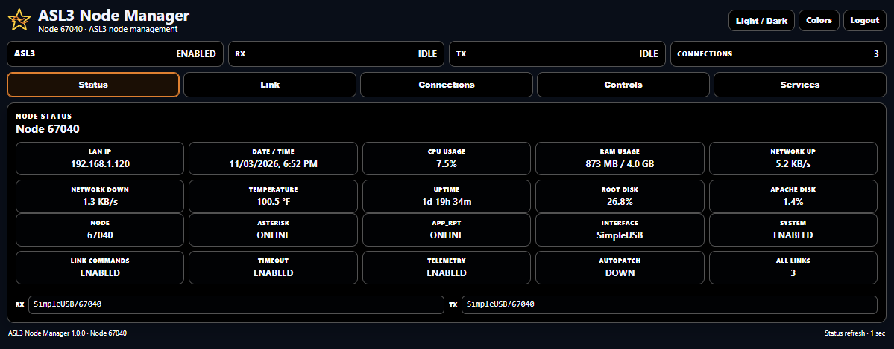
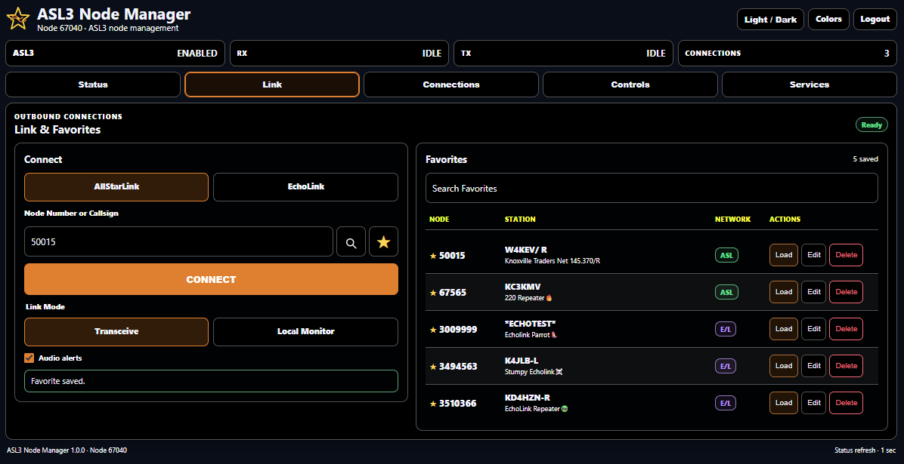
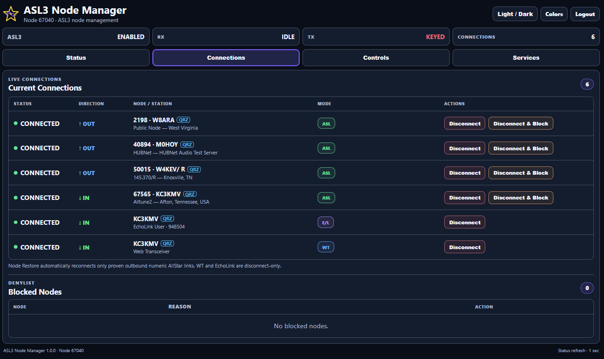
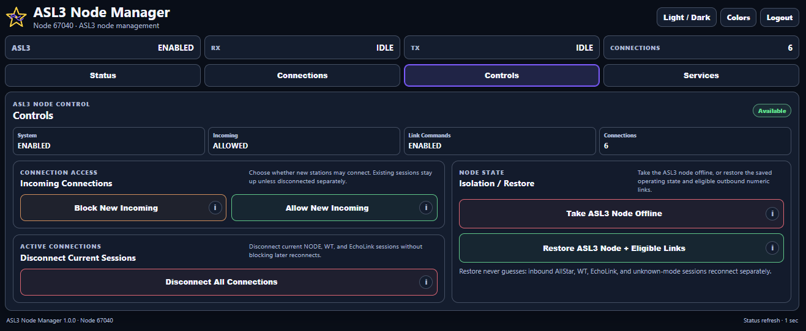
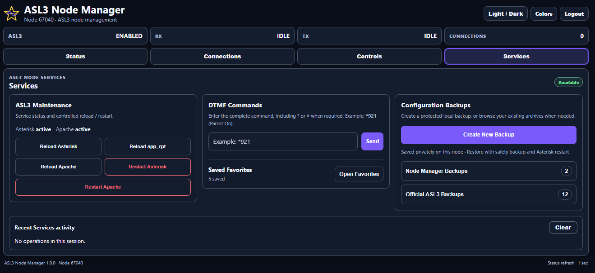

# ASL3 Node Manager

ASL3 Node Manager provides a simple, mobile-friendly web interface and command-line utility for monitoring and managing an AllStarLink 3 node.

**Tested on AllStarLink 3 running Debian 13 (Trixie).** Other Debian-based ASL3 installations may work but have not been tested.

## Screenshots

Shown in dashboard tab order: **Status → Link → Connections → Controls → Services**.

**Status**


**Link**


**Connections**


**Controls**


**Services**


## Apache Logging After ASL3 Updates

ASL3 appliance updates may replace Apache access-log settings, allowing routine polling requests to accumulate in `/var/log/apache2/access.log`.

After updating ASL3, rerun the local installer to restore the shared polling-log filtering:

    cd /var/www/html/asl3_node_manager
    sudo ./setup_asl3_node_manager.sh

Existing application settings are preserved. Normal requests and errors continue to be logged.

## Status

The Status panel displays 20 monitoring blocks in two groups.

**System Information (top 10):** LAN IP, local date/time, CPU usage, RAM usage, network upload/download rates, temperature (°F), uptime, root disk usage, and Apache disk usage.

**Node Status (bottom 10):** Node number, Asterisk, app_rpt, radio interface, system state, link commands, timeout, telemetry, autopatch, and connected-link count.

RX/TX channel information appears below the blocks. System metrics are refreshed approximately every 5 seconds while dashboard status polling continues every 1 second. Unavailable hardware measurements display N/A.

## Link & Favorites

The **Link** panel connects to AllStarLink or EchoLink by node number or callsign lookup. Select **Transceive** or **Local Monitor Only** before connecting; switching modes requires disconnecting and reconnecting. A disabled EchoLink option indicates that the channel driver is unavailable. EchoLink outgoing connections are limited to one at a time, and incoming callers are protected by the guarded connection sequence.

**Link Favorites** are separate from Services DTMF Favorites. On mobile, each Favorite shows its station and description beneath the node number, with Load, Edit and Delete controls alongside. Save a node, station name, description, network and selected mode; search, Load, Edit or Delete from the Link panel. Loading a Favorite does not connect until you press Connect. Favorites saved on another device appear after refreshing that device; live cross-browser synchronization is not enabled.

Optional **Audio Alerts** announce connection changes with a language-matched browser voice (Microsoft Zira preferred on compatible Windows installations). Speech availability depends on your browser/device. The setting persists across sessions.

## Connections

View active connections, see who's connected, and manage individual sessions.

| Mode | Connection type | Available actions |
|---|---|---|
| **ASL** | AllStarLink nodes | Disconnect, Disconnect & Block, Restore Access |
| **WT** | Web Transceiver / named IAX/IAX2 | Disconnect |
| **E/L** | EchoLink | Disconnect |

Connection direction is shown separately:

- **↑ OUT** — Your node initiated the connection.
- **↓ IN** — The remote station connected to your node.

When a connected station keys up, its row turns red and moves to the top of the list.

EchoLink connections display their resolved callsign and official EchoLink node number when available. **QRZ** links beside recognized callsigns open their QRZ.com lookup in a new tab. WT and EchoLink connections are disconnect-only and are not added to the AllStar denylist.


## Controls

The Controls tab provides five node-wide actions:

- **Block New Incoming** — Prevents new incoming connections without disconnecting existing ones.
- **Allow New Incoming** — Allows incoming connections again.
- **Disconnect All Connections** — Disconnects current ASL, WT/IAX2, and EchoLink sessions without blocking future connections.
- **Take ASL3 Node Offline** — Saves the operating state, disconnects active sessions, blocks incoming access, and disables the app_rpt system and linking commands.
- **Restore ASL3 Node + Eligible Links** — Restores the saved operating state and reconnects eligible outgoing AllStar links in their original mode.

**How connection restore works**

**Outgoing connection from your node:**
Node Manager restores it automatically only when its current session and original mode can be verified as Transceive.

**Incoming connection to your node:**
Node Manager cannot recreate that same incoming session. It can only turn incoming access back on so the remote node can reconnect.

Automatic reconnection currently supports verified outgoing **Transceive** (`ilink 3`) links. **Local Monitor Only** (`ilink 8`) and ambiguous receive-only connections are deliberately skipped rather than reconnected in a different mode. Skipped or unclassified links are reported as requiring attention. Connections changed externally (for example, through AllStar Connect) are not deliberately overridden. WT/IAX2, EchoLink, and incoming links are not automatically reconnected. Restoring an eligible Transceive link took approximately **10 seconds** in testing on node67040; actual times vary.

Taking the node offline does not shut down the computer, radio, or repeater hardware.


## Services

**ASL3 Maintenance:** Reload Asterisk configuration or app_rpt, reload Apache, or restart Asterisk/Apache. Restarting services can interrupt active sessions. Administrative login is required for these actions.

**DTMF:** Send a full DTMF command to the configured local node (include `*` or `#` when needed). Favorites can be saved, loaded, edited, removed, and sorted; loading does not send the command.

**Configuration Backups:** Node Manager can create, verify, download, delete (with confirmation), and restore its own Asterisk configuration backups. It also lists, verifies, downloads, deletes (with confirmation), and restores existing official ASL3 `asl-menu` archives. A live restore makes an additional protected safety backup, stops Asterisk for file/database replacement, and restarts it. Restoration disconnects active links and may revert settings to the archive date. **Restore only a backup whose contents and date you trust.** Official archives may also contain Allmon3 configuration files; restoring them does not enable or start Allmon3. Backup archives live under `/var/backups/asl3-node-manager/asl3-config/` and official archives under `/var/asl-backups/`. Deleting an official archive permanently removes that file from `/var/asl-backups/`, including its appearance in `asl-menu`; safety backups are never offered for deletion. After creating or deleting a backup, refresh the page if a list or count has not updated. Changes made from another device may also require a refresh. **Recent Services activity** is a temporary, scrollable log with a **Clear** button on the right.

## Appearance and Login

Choose between Light and Dark themes, or customize the background, cards, text, headings, and accent colors. Separate custom profiles are available for each theme.

Appearance settings are saved on the node and shared between open browsers.

Administrator login is optional. When enabled, visitors can view the dashboard without signing in, but controls require login.

The administrator username is `admin`.

## Installation

```bash
cd /var/www/html
sudo git clone https://github.com/TerryClaiborne/asl3_node_manager.git asl3_node_manager
cd /var/www/html/asl3_node_manager
sudo ./setup_asl3_node_manager.sh
```

If your node cannot be detected automatically, specify it during installation:

```bash
sudo ./setup_asl3_node_manager.sh --node YOUR-NODE-NUMBER
```

Open the dashboard at:

```text
http://YOUR-NODE-IP/node-manager/
```

The installer configures Apache, the restricted control helper, sudoers permissions, and application files. Local settings and data are preserved during updates.

### Administrator password

To set or change the administrator password and enable login:

```bash
sudo /var/www/html/asl3_node_manager/setup_asl3_node_manager.sh --set-admin-password
```

To disable or re-enable login:

```bash
sudo /var/www/html/asl3_node_manager/setup_asl3_node_manager.sh --disable-auth
sudo /var/www/html/asl3_node_manager/setup_asl3_node_manager.sh --enable-auth
```

## Updating

```bash
cd /var/www/html/asl3_node_manager
sudo git pull origin main
sudo ./setup_asl3_node_manager.sh
```

Updates preserve local configuration, login settings, appearance preferences, and runtime data.

## Configuration

Local configuration is stored in:

```text
/var/www/html/asl3_node_manager/config.ini
```

| Setting | Purpose |
|---|---|
| `MYNODE` | Local AllStar node number, normally detected during installation |
| `ASL3_NODE_MANAGER_AUTH_ENABLED` | `0` disables login; `1` enables login |
| `ASL3_NODE_MANAGER_ADMIN_USER` | Administrator username (`admin`) |
| `ASL3_NODE_MANAGER_ADMIN_PASSWORD_HASH` | Secure password hash generated by the setup script |

For example:

```ini
MYNODE="67040"
ASL3_NODE_MANAGER_AUTH_ENABLED=1
ASL3_NODE_MANAGER_ADMIN_USER="admin"
ASL3_NODE_MANAGER_ADMIN_PASSWORD_HASH=""
```

The password hash shown above is only a placeholder. **Use `--set-admin-password` to create the actual hash.** Do not enter a plain-text password.

Your local `config.ini` is excluded from Git and preserved during updates.

## Command Line

Node Manager can also display node status directly in the terminal:

```bash
sudo /var/www/html/asl3_node_manager/bin/asl3-node-manager status
```

JSON output:

```bash
sudo /var/www/html/asl3_node_manager/bin/asl3-node-manager status --json
```

Available commands:

```bash
sudo /var/www/html/asl3_node_manager/bin/asl3-node-manager --help
```

## Uninstall

```bash
sudo /var/www/html/asl3_node_manager/setup_asl3_node_manager.sh --uninstall
```

The uninstall procedure creates a protected backup before removing Node Manager and its dedicated system integration.
